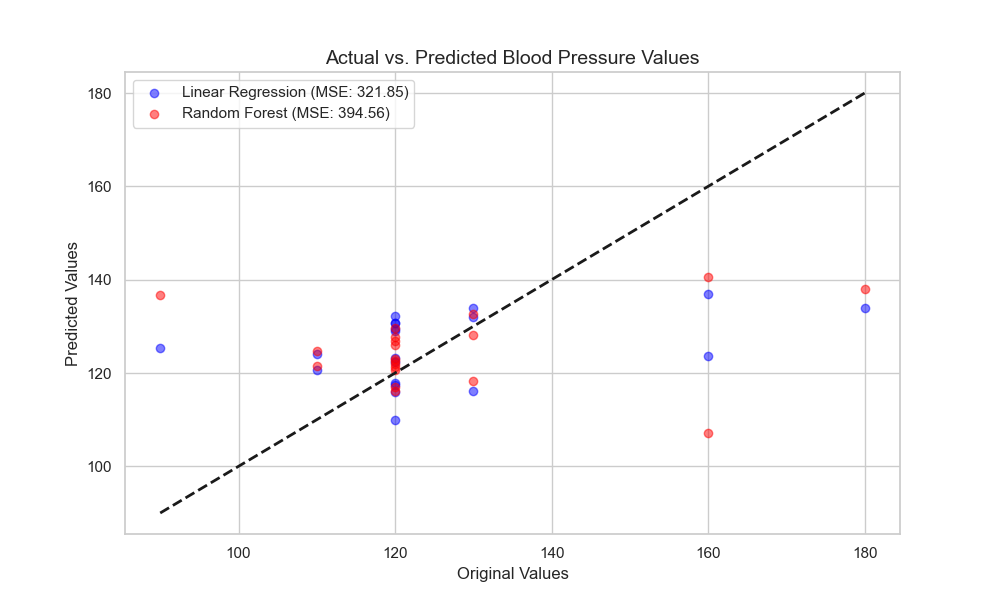

# Blood Pressure Analysis: Regression vs. Random Forest in Python and R

How well do five routine cardiovascular risk factors (age, BMI, cholesterol, glucose and physical
activity) predict systolic blood pressure (SBP)? The same analysis is built twice, in Python and
in R, and compares Multiple Linear Regression with a Random Forest Regressor.

**Stack:** Python (pandas, scikit-learn, seaborn) · R (tidyverse, randomForest, caret) · LaTeX report



## Pipeline

1. **Sampling:** filters unrealistic SBP values and draws a reproducible sample of 100 adults (seed 42).
2. **Descriptive statistics** for every variable (`figures/summary_statistics.csv`).
3. **Outlier detection** with the IQR rule and box plots, including where the rule breaks down for
   categorical and binary variables.
4. **Correlation:** pairwise Pearson correlations and a scatter-plot grid.
5. **Models:** Multiple Linear Regression and Random Forest Regressor, evaluated with MSE, RMSE and R².

## Results

| Model | RMSE (mmHg) | R² |
|---|---|---|
| Multiple Linear Regression | 15.35 | 0.015 |
| Random Forest Regressor | 14.73 | 0.009 |

Random Forest has slightly lower error, but **both models explain under 2% of the variance in SBP**.
The report argues that this reflects how many factors drive hypertension (diet, genetics, medication,
stress) rather than a modelling failure, and that useful prediction needs much richer features.

The full write-up, with a review of ten source papers, is in [`report/report.pdf`](report/report.pdf).

## Data

The [Cardiovascular Disease dataset](https://www.kaggle.com/datasets/sulianova/cardiovascular-disease-dataset)
(70,000 records, semicolon-separated) is not included. Download `cardio_train.csv` and place it
next to the script you run.

## Running

```bash
# Python
pip install -r requirements.txt
cd python && jupyter notebook analysis.ipynb

# R
cd R && Rscript analysis.R      # needs tidyverse, randomForest, caret
```

Both write the figures shown in `figures/`.

## Limitations

- A sample of 100 is small, and a single train/test split gives noisy error estimates.
- Cholesterol and glucose are coarse 1–3 categories, and activity is binary, which limits what any model can learn.
- No formal hypothesis tests on the regression coefficients are reported.

> **Team project.** Advanced Statistics, FAST-NUCES (Spring 2026), by Ibrahim Ghauri and Muhammad Mudassir.

## Licence

MIT; see `LICENSE`. The dataset is subject to its provider's terms.
